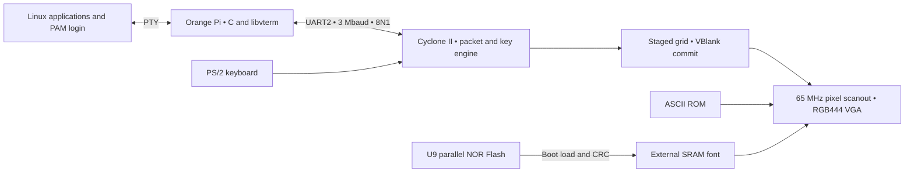

# SUPERFACE

SUPERFACE is a physical Linux terminal built from an Orange Pi Zero 2W and a Terasic DE1 FPGA board. It gives an ordinary Linux shell a VGA monitor and a PS/2 keyboard while keeping terminal emulation, applications, and authentication on Linux. The FPGA drives a fixed 80 × 30 character terminal with independently selectable ANSI 16-color foregrounds and backgrounds.



## Wiring

Connect the boards with short 3.3 V logic leads and keep their power supplies independent. Set the DE1 RUN/PROG switch to RUN for volatile JTAG configuration.

| Orange Pi Zero 2W header | DE1 JP1 / GPIO_0 |
| --- | --- |
| Pin 15, PI5 TX | Pin 2, GPIO_0[1], B13 RX |
| Pin 22, PI6 RX | Pin 3, GPIO_0[2], A14 TX |
| Pin 14, GND | Pin 12, GND |

UART2 uses `/dev/ttyS2`, a 48 MHz reference, 3,000,000 baud, 8N1, idle-high signaling, and no flow control. The FPGA UART PHY runs at 24 MHz and crosses into the 50 MHz system through dual-clock FIFOs. Use the GPIO pins directly. The DE1 DB-9 carries RS-232 voltage levels. [Orange Pi UART2 setup](docs/SUPERFACE_UART2.md) · [Wire protocol](docs/SUPERFACE_PROTOCOL.md)

## Display and performance

SUPERFACE 1.1 was verified on a physical VGA monitor at 1024 × 768 at nominal 60 Hz. Its 65 MHz Cyclone II PLL drives only VGA. The horizontal timing is 1024 active, 24 front porch, 136 sync and 160 back porch, for 1344 total. The vertical timing is 768 active, 3 front porch, 6 sync and 29 back porch, for 806 total. Both syncs are negative. The Phase 8 rollback release runs at 640 × 480. [Phase 8 rollback release](https://github.com/clementnie/SUPERFACE/releases/tag/v1.0.0)

The centered 960 × 720 terminal has 32-pixel side margins, 24-pixel top and bottom margins, and 12 × 24 output pixels per cell. Each output coordinate maps to `floor(2 × offset / 3)` on its bitmap axis. It preserves the original 8 × 16 ASCII and terminal graphics, 12 × 12 Chinese bitmaps and two-cell Chinese layout, punctuation, and missing glyphs. The same nearest-neighbor sampling scales the cursor and boot screen. The Phase 8 U9 font image is compatible.

A negotiated extension stages changed spans against a shadow grid. One VBlank operation publishes the entire staged image and cursor. Each staged row is validated and acknowledged promptly, and keyboard packets have their own reliable sequence space. The original protocol profile stays available for legacy firmware.

| Benchmark | Result |
| --- | ---: |
| Single-cell visible ACK | 16.66 ms |
| Multiline visible ACK | 16.48 ms |
| Full-screen visible ACK | 49.92 ms |
| Clear-screen visible ACK | 49.88 ms |
| Sparse coherent updates | 60.01 Hz |
| Original full-screen baseline | Approximately 504 ms |

The physical 3 Mbaud measurements time the final visible-commit ACK, including serial transfer, staging and VBlank. Multiline means eight short spans on separate rows; sparse means four changed rows per update. **60.01 Hz is the sparse update frequency, not an arbitrary full-screen frame rate.** A raw 7,200-byte screen alone takes at least 24 ms to serialize. Application execution and monitor response are excluded. [Verification record](docs/VERIFICATION.md)

The sealed Cyclone II EP2C20F484C7 fit uses 5,197 / 18,752 logic elements (28%), 2,655 registers, 50 / 52 M4Ks, 148,128 / 239,616 memory bits (62%), 155 / 315 pins and 1 / 4 PLLs. Slow-model setup slack is +4.362 ns at 65 MHz, +6.212 ns at 50 MHz and +30.633 ns at 24 MHz; worst fast-model hold slack is +0.215 ns. Gray-pointer routes meet their 10 ns bounds. The inherited SW[0] lab clock warning remains. [Accepted release and timing evidence](docs/RELEASE-v1.1.0.md)

## Character coverage

The canonical map covers 95 printable ASCII characters, 6,727 Simplified Chinese Han characters, 117 wide punctuation and full-width characters, and 652 single-cell terminal symbols. It includes Box Drawing, Block Elements, Braille Patterns, Arrows, most printable Latin-1 characters, and selected geometric, mathematical and typographic characters. The negotiated profile preserves character width for missing symbols and draws an outlined placeholder with the current colors. The two placeholders live in FPGA logic and work in ASCII fallback. The manifest lists exact code points and the font image identity. [Font assets](docs/SUPERFACE_FONT_ASSETS.md) · [Manifest](assets/fonts/font_manifest.json)

## Build and run

1. Use Quartus II 13.0 SP1 with Cyclone II support. Put `quartus_sh` on `PATH`, then run `sh lab8_restored/tools/build_phase5.sh /tmp/sf-board`. The script builds in a clean copy and produces `LAB8.sof`. Load it via the USB-Blaster in JTAG mode.
2. On a fresh DE1, preserve the complete U9 Flash contents and program the matching font image using the [PFL procedure](host/flash/README.md). Existing Phase 8 installations can reuse their verified U9 font image. The host and FPGA require the same mapping identity. They negotiate ASCII fallback if the font is unavailable or mismatched.
3. On the Orange Pi, run `sh host/deps/build-libvterm.sh`, then `make -C host check`. The dependency is pinned and built statically. Use the [service installation instructions](host/service/README.md) to install the checked executables, terminfo, systemd unit, and restricted UART udev rule.
4. With the service enabled and the DE1 configured, log in on VGA with the PS/2 keyboard. See the keyboard layout commands below.
5. Run `sh host/service/verify-display` for a mixed-language, color and glyph check. Run `sh host/service/verify-display web` for the local UTF-8 ELinks fixture.

Phase 8.1 passed standalone cold boot using EPCS4 on the DE1 and the 48 MHz UART2 boot default on the Orange Pi. The local terminal service starts and reconnects independently of SSH or Wi-Fi. The release includes the verified EPCS4 programming file and the [standalone setup and rollback instructions](host/service/README.md#standalone-boot). See the [verification record](docs/VERIFICATION.md) for the actual deployment status. The terminal has a fixed palette and character-cell graphics. Text shaping, bidirectional layout, emoji collections, and Chinese composition input are outside its scope.

### Keyboard layout

The production service uses standard Colemak for the physical login prompt and shell. Physical Caps Lock sends Backspace and repeats when held. The physical Backspace key works in both layouts. QWERTY uses conventional Caps Lock.

Run these commands on the Orange Pi. The layout applies to the physical login prompt and shell and persists across boots.

```sh
sudo superface-layout colemak
sudo superface-layout qwerty
superface-layout status
```

Each layout change restarts `superface.service` and **terminates the current physical login session**. Use SSH or the UART0 console when you need the command session to stay open.

## Release and licensing

Download the exact accepted SOF, EPCS4 image, ARM64 package, font and mapping from [v1.1.0](https://github.com/clementnie/SUPERFACE/releases/tag/v1.1.0), and verify `SHA256SUMS`. The ARM64 package includes the matching service installer and layout utility; the source archive includes deployment and Flash tools. [Release provenance](docs/RELEASE-v1.1.0.md) records the accepted build revision and artifact identities. [v1.0.0](https://github.com/clementnie/SUPERFACE/releases/tag/v1.0.0) remains the independently verified 640 × 480 rollback release.

Original project code and documentation use [GPL-2.0-only](LICENSE). Prior MIT grants, vendor IP terms, libvterm's MIT notice and all upstream font licenses remain intact. See [licensing scope and third-party notices](LICENSING.md).
